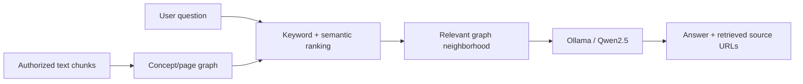

# Erica — GraphRAG AI Tutor

A standalone demonstration of the GraphRAG approach used in our academic AI tutor: concept and page graphs, hybrid semantic/keyword concept ranking, one-hop subgraph retrieval, source references, and optional local Ollama generation.

**Maintained by Akshat Agrawal.** This public demo uses separately written code and independently prepared synthetic data. It reflects general techniques explored in an earlier academic project jointly developed by Akshat Agrawal and Krinal Kathiriya. It is **not an export of the collaborative implementation** or an official NYU product.

## Architecture



## Quick start

Requires Python 3.10+.

```bash
python3 -m venv .venv
source .venv/bin/activate
pip install -r requirements.txt
python -m examples.build_demo
python -m erica.cli --query 'Explain transformer attention' --offline
python -m unittest discover -s tests -v
```

Offline mode retrieves graph context and source URLs **without generating an answer**. For an answer using a local Ollama installation:

```bash
ollama pull qwen2.5:3b
ollama pull nomic-embed-text
# Run ollama serve separately if needed.
python -m erica.cli --query 'Explain transformer attention'
```

By default Ollama is expected at `http://localhost:11434`. If connecting from Docker to Ollama on the host, set `OLLAMA_BASE_URL=http://host.docker.internal:11434`.

## Source map

| Component | Location |
| --- | --- |
| Page–concept graph construction | [erica/graph.py](erica/graph.py) |
| Hybrid ranking and graph-neighborhood selection | [erica/retrieval.py](erica/retrieval.py) |
| Ollama generation and embeddings | [erica/llm.py](erica/llm.py) |
| Command-line interface | [erica/cli.py](erica/cli.py) |
| Six-page synthetic example | [examples/build_demo.py](examples/build_demo.py) |
| Offline regression tests | [tests/test_erica.py](tests/test_erica.py) |

## Original Erica project — historical project-scale metrics

The **original collaborative academic Erica project**, co-developed by Akshat Agrawal and Krinal Kathiriya, reported:

| Original project metric | Reported result |
| --- | ---: |
| Scraped AI course pages | **519** |
| Lecture video references | **52** |
| Prepared text chunks | **24,753** |
| Knowledge-graph concepts | **83** |
| Course-page nodes | **130** |
| Graph edges | **2,300+** |

These figures belong to the **original academic implementation**, not a benchmark of the small public demo. They are reported in the original project documentation and were **not independently remeasured** from the original corpus for this release.

**What this public repository runs:** an independently written, streamlined GraphRAG implementation with a six-page synthetic corpus. The original coursework, scraped page text, transcripts, and saved knowledge graph are deliberately excluded.

## Scope and limitations

The code uses NetworkX to link pages to concepts, keyword overlap and optional embedding cosine similarity to rank concepts, and Ollama/Qwen2.5 to generate answers from retrieved context.

- Source URLs are retrieved graph references, **not** a verified attribution for every model-generated statement.
- The offline tests exercise retrieval and CLI behavior; they do not measure retrieval accuracy or generation quality.
- This is a CLI demonstration, not a deployed production system.
- Historical full-corpus counts are not reproducible using the six-page synthetic example.

Next steps include citation and abstention evaluation, a safely licensed benchmark corpus, demo screenshots, and end-to-end performance measurements.

## Credits

See [CONTRIBUTORS.md](CONTRIBUTORS.md) for the distinction between the original academic project and this standalone demonstration. No license has been selected pending confirmation of rights to all published materials.
